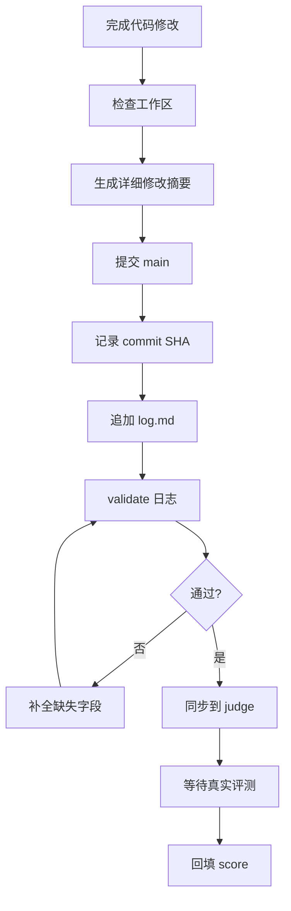

# Submission Log Workflow

这个 skill 用于把一次 agent 修改的生命周期写成可追踪记录：开发、提交、同步到 `judge`、拿到真实评测分数、再回填日志。

## 何时使用

- 你要把 `main` 的变更提交到 `judge`
- 你要为一次优化补写详细修改日志
- 你要给某个 commit 回填真实评测分数
- 你要检查日志是否完整、是否能提交

## 工作流



## 记录规则

1. 每次 `main -> judge` 提交都要追加一条记录，不能覆盖历史。
2. 记录必须包含 `commit_sha`、`timestamp`、`change_summary`、`logic_details` 和 `validation`。
3. `score` 首次允许留空，但提交前校验仍要通过。
4. 真实分数只能后续回填，不能猜测。
5. 不得记录数据集、标准答案、模型原始响应或 API key。
6. 不得用题目关键词、`idx` 或历史结果硬编码摘要或分数。

## 使用方式

### 追加记录

用脚本把一次提交写入 `log.md`：

```bash
python skills/submission-log-workflow/scripts/record_submission.py append \
  --log skills/submission-log-workflow/log.md \
  --commit-sha <full-sha> \
  --source-branch main \
  --target-branch judge \
  --title "fix: improve equivalence validation" \
  --summary "Add denominator and variable-position checks for equivalence steps." \
  --logic-details "1. Check each transformed fraction against the original.\n2. Reject inconsistent equivalent forms.\n3. Store rejection reasons in error_memory." \
  --validation "python -m unittest discover -s tests -p 'test_*.py'"
```

### 校验记录

```bash
python skills/submission-log-workflow/scripts/record_submission.py validate \
  --log skills/submission-log-workflow/log.md \
  --source-branch main \
  --target-branch judge
```

### 回填分数

```bash
python skills/submission-log-workflow/scripts/record_submission.py update-score \
  --log skills/submission-log-workflow/log.md \
  --commit-sha <full-sha> \
  --score 0.4286 \
  --score-source "judge run 2026-08-09" \
  --score-notes "112 tasks, normalized accuracy"
```

## 记录格式

每条记录追加到 `log.md`，格式示例：

```markdown
## 2026-08-09T12:00:00+08:00 - fix equivalence validation

- source_branch: `main`
- target_branch: `judge`
- commit_sha: `0123456789abcdef0123456789abcdef01234567`
- timestamp: `2026-08-09T12:00:00+08:00`
- status: `submitted`
- score:
- score_source:
- score_updated_at:
- score_notes:
- validation: `python -m unittest discover -s tests -p 'test_*.py'`
- change_summary: Add denominator and variable-position checks.
- logic_details:
  - Validate equivalence transformations step by step.
  - Reject conflicting formulas in the same step.
  - Preserve error memory for repeated failures.
- notes: Score will be filled after judge finishes.
```

## 提交前门槛

在真正提交前，先确认：

- `log.md` 里这条记录已经存在
- `commit_sha` 是完整 40 位 SHA
- `change_summary` 和 `logic_details` 不是空的
- `validation` 已填写
- 不包含数据集、输出结果或其它不该提交的文件
